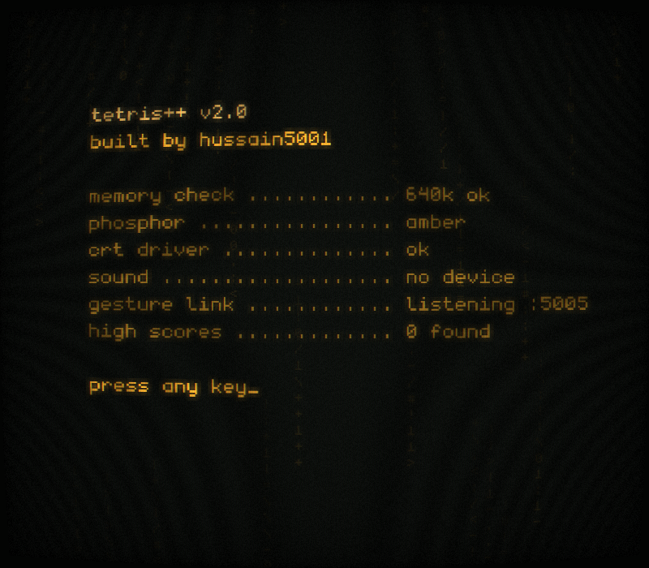
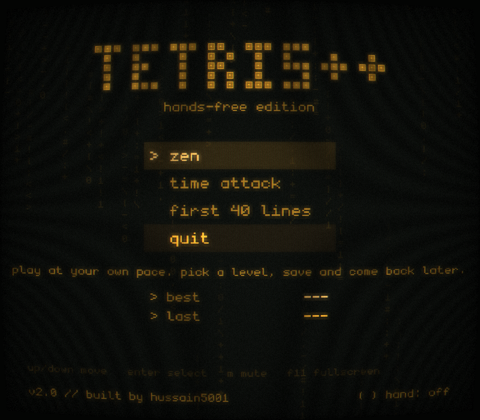
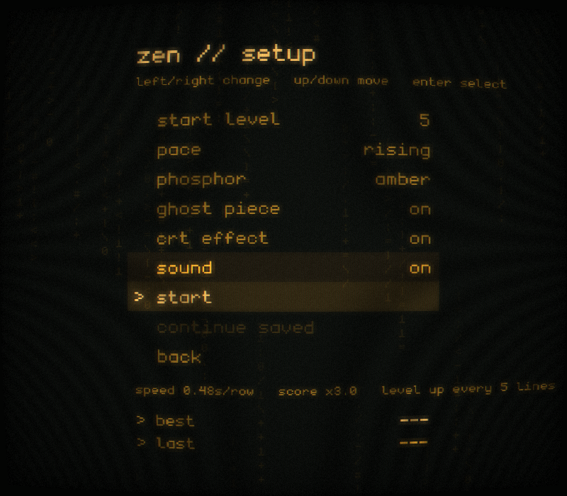
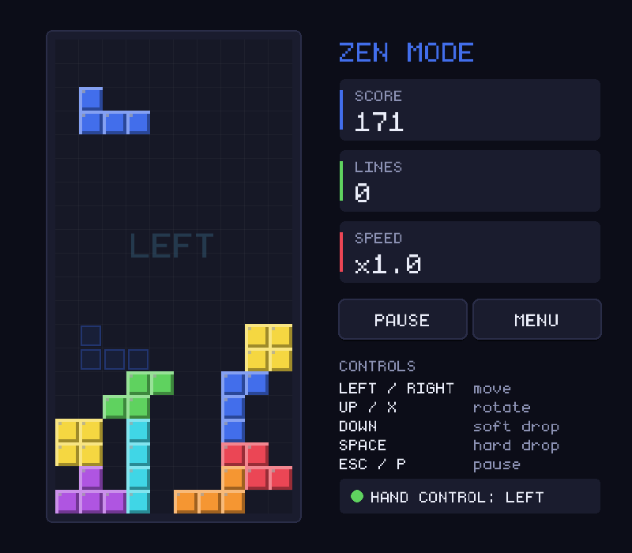
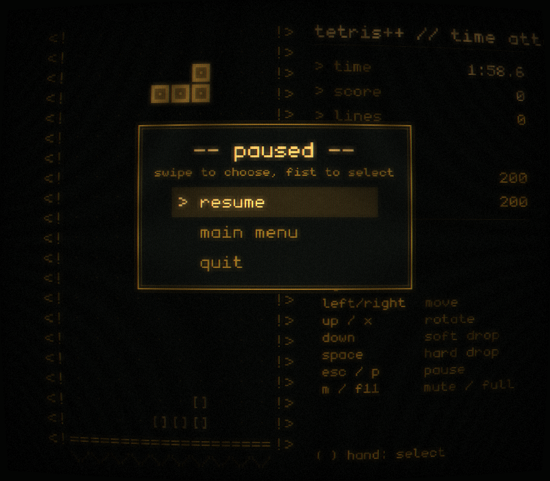
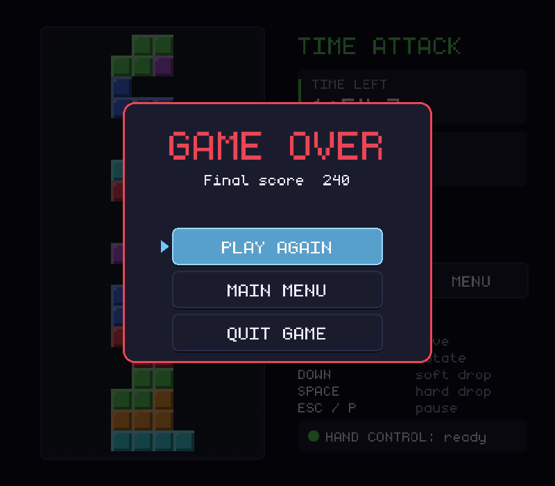

# Tetris++ — hands-free edition

An extended version of **TetrisX**, our university C++ Tetris clone
([Hussain5001/tetris](https://github.com/Hussain5001/tetris)). The original
repository is left untouched; this one adds:

- **A night-terminal look.** Amber or green phosphor on black, shown through a CRT effect with
  curved glass, scanlines and glow. The well is framed with `<! !>` like the 1984 original.
- **Zen levels.** Choose a start level (speed and score multiplier) and a pace (how quickly it
  speeds up), plus quick settings, all remembered between runs.
- **Smoother play.** A next-piece preview, lock delay, wall kicks, a sliding block, a 3-2-1 countdown, line-clear
  sparks, a hard-drop trail and generated sound effects.
- **High scores.** The best five results and your last run for every mode, saved to `scores.json`.
- **Hands-free play.** A small Python program watches your webcam, recognises hand
  gestures with MediaPipe and sends them to the game.

| Boot | Menu | Zen setup |
|---|---|---|
|  |  |  |
| **Playing** | **Paused** | **Game over** |
|  |  |  |

## Play on Windows

**Easiest: download the ready-made game, no compilers needed.**

1. Open the repo's [Actions → build](https://github.com/Hussain5001/tetrisPlusPlus/actions/workflows/build.yml)
   page, click the newest green run, and download **TetrisPlusPlus-windows** under *Artifacts*.
   Tagged versions also appear under *Releases*.
2. Unzip it anywhere, for example your Desktop.
3. Double-click **`Tetris.exe`** and play with the keyboard.
4. Press **H** in the game to switch hand control on. Press **H** again to switch it off and go
   back to the keyboard; the keys work the whole time anyway.

Hand control needs [Python 3.10–3.12](https://www.python.org/downloads/); tick "Add python.exe
to PATH" when installing. The first time you switch it on, a minimised "Tetris++ hand control"
window installs MediaPipe (a minute or two). Then the camera preview opens and the game's status
line (bottom of the screen) changes from `hand: starting` to `hand: ready`.

## Building from source

Tetris++ is a Windows game. To change the code, use `build.bat`:

```powershell
winget install Git.Git Kitware.CMake
winget install Microsoft.VisualStudio.2022.BuildTools --override "--add Microsoft.VisualStudio.Workload.VCTools --includeRecommended --passive"
git clone --recursive https://github.com/Hussain5001/tetrisPlusPlus.git
cd tetrisPlusPlus
.\build.bat          # builds, then starts the game
```

`build.bat` downloads raylib and nlohmann/json (git submodules) if they are missing and puts the
game in `build\Release\Tetris.exe`. Run it again after changing the code.

## Keyboard controls

| Key | Action |
|---|---|
| ← / → (hold to repeat) | move |
| ↑ or X | rotate |
| ↓ | soft drop |
| Space | hard drop |
| Esc or P | pause (the game also pauses when its window loses focus, unless hand control is connected) |
| Enter | select in menus |
| H | hand control on/off (starts and closes the camera) |
| M | sound on/off |
| F11 | fullscreen |

## Zen setup

Choosing **zen** opens a setup screen. Use ← / → to change a value and ↑ / ↓ to move:

| Setting | What it does |
|---|---|
| start level 1–10 | Starting speed, from 0.80 s per row at level 1 to 0.10 s at level 10. Each level adds ×0.5 to the score multiplier, so level 5 scores ×3. |
| pace | How often you level up: **chill** every 10 lines, **steady** 8, **rising** 5 (the original), **brutal** 3. Past level 10 it keeps speeding up down to 0.05 s per row. |
| phosphor | **amber**, **green**, or **multi** (muted colours per block) |
| ghost piece | Show where the block will land |
| crt effect | The curved-glass/scanline effect; turn it off on slow machines |
| sound | Generated terminal-style beeps |

Choices are saved in `profile.json`. **continue saved** loads a game saved with *save & quit* from the pause menu.

## High scores

Every finished game is saved to `scores.json` straight away: the **top 5** for each mode, plus your
**last run** (even when it isn't a high score). The menu shows the best and last result for the
selected mode, and the game-over screen shows your rank and the table. First 40 Lines ranks by the
fastest time and only counts games where you actually cleared 40 lines.

## Hands-free play (camera gestures)

**Press H in the game** (or choose *hand control* in the main menu) to switch between your hand
and the keyboard. There is nothing to restart and no window to close:

- **On**: the game starts the camera script (`gesture\run_windows.bat`) in a minimised window.
  The status line shows `hand: starting`, then `hand: ready` once the camera preview is up.
- **Off**: the game tells the camera script to close, and the camera and its windows go away.
- The keyboard works the whole time, also while hand control is on.
- The choice is remembered in `profile.json`, so hand control comes back on the next start, and
  the camera script always closes when the game does.

`run_windows.bat` needs Python 3.10–3.12. On its first start it creates a Python environment in
`%LOCALAPPDATA%\tetrisplusplus` and installs the packages pinned in `gesture/requirements.txt`
(MediaPipe and OpenCV); it rebuilds that environment whenever the file changes.
The first run also downloads the MediaPipe hand model (about 8 MB) to `gesture/models/`.

You can also start the camera script yourself while the game is open, for example to try another
mode: `gesture\run_windows.bat --mode flick`. The game picks it up and H closes it.

Hold your **open hand** in front of the camera, palm towards it:

| Gesture | In game | In menus |
|---|---|---|
| Move the hand left / right | the piece goes to the column under your hand | |
| Pinch (thumb to index fingertip) | rotate | move the selection up |
| Close the hand into a fist | hard drop | select |
| Take the hand out of the picture | the game pauses after 1.5 seconds | |

This is **follow mode**. It needs one hand movement, up to three pinches and one fist for each
piece, and nothing depends on how fast you move:

- The camera window shows a grey box: the zone your hand moves in, which stands for the whole
  board. A marker under the well in the game shows the column your hand is over.
- A drop lands where your hand was just before it started to close, so closing the hand doesn't
  nudge the piece.
- Open the hand again after a drop; a fist that stays closed drops only once.
- A relaxed hand with slightly curled fingers is fine. Only a real fist drops.
- The arrow keys still work. After you move a piece with them, it stays there until your hand
  moves to another column. If you carry on with the keyboard after taking your hand away, the
  game doesn't pause.
- To continue after the pause, bring your hand back and make a fist on *resume*.

Tuning:

- Press `c` in the camera window to put the middle of the zone where your hand is now.
- `gesture\run_windows.bat --reach 2.5` makes the zone narrower (less arm movement, less precise);
  the default is 3 hand sizes from the left wall to the right wall.
- The camera window shows how closed the hand is (`fist`) and how far apart thumb and index
  finger are (`pinch`), next to the values that trigger. All thresholds are in
  `gesture/gestures.py` (`Config`).
- Measuring instead of guessing: `gesture\run_windows.bat --stats` prints the real frame rate,
  the tracking time and how often the hand was lost. `--record clip.jsonl` saves every frame's
  hand landmarks; `py gesture/replay.py clip.jsonl --expect U=20 --set pinch_on=0.32` then runs
  the detector over exactly those movements with other settings and counts missed, extra and
  false commands (`--help` explains the options).
- Good lighting and a plain background help MediaPipe the most.

#### Older modes

The earlier gesture modes are still there for now. Start the camera script yourself with
`gesture\run_windows.bat --mode flick`, or press `m` in the camera window:

| Mode | How it works |
|---|---|
| `flick` | point with the index finger; each swipe of it moves one column, dipping it drops, a pinch rotates, an open palm held for a second pauses |
| `point` | like `flick`, but tilt the finger and **hold** it to keep moving |
| `palm` | swipe an open hand; a held fist pauses / selects (`--mode swipe` also works) |
| `position` | the piece follows the hand sideways; a held fist pauses / selects |

`--sensitivity 1.3` makes smaller swipes count in these modes and `--no-vertical` turns their
drop off.

### How it works

```
webcam ──► hand_control.py ──(UDP 127.0.0.1:5005, e.g. "X512Y430", "U", "H")──► Tetris
           MediaPipe landmarks                                            InputManager
           → gestures.py                                                  → Game::apply(Action)
```

Each message holds one or more commands:

| Command | Meaning |
|---|---|
| `X<n>` `Y<n>` | where the hand is in its zone, 0–999 from the left / top edge (follow mode, every frame) |
| `U` | rotate |
| `H` | hard drop (select in menus) |
| `L` `R` | move one column left / right |
| `D` | soft drop |
| `P` | pause / resume |
| `C` | confirm (pause in game, select in menus) |
| `B` | back |
| `@<n>` | move the piece to column n (the old position mode) |
| `K` | keep-alive, sent twice a second |

The game reads the UDP socket without blocking every frame, so a gesture takes effect on
the next frame after it arrives. The socket only listens on this computer (127.0.0.1). Any
other program that sends these letters can drive the game too; `tests/smoke_test.py` does.

The link goes both ways. Twice a second the camera script sends `K` ("I'm here") and the game
answers `k`. To switch hand control off the game sends `Q` and the script closes; a script
started by the game also closes by itself when the answers stop for five seconds.

## Tests

```powershell
build\Release\Tetris.exe --test           # C++ tests; exits with an error if any fail
py -m unittest discover -s gesture       # Python tests (gesture detector, camera script, replay)
py tests/smoke_test.py build/Release/Tetris.exe   # plays the real game (opens its window)
```

- **C++** (`src/tests/`, including the original project's tests in `TestLegacy.h`): movement, the piece bag,
  soft/hard drop and ghost, gravity, lock delay, wall kicks, game over, line clearing, Zen levels,
  pace, multiplier and save files, the pause-aware timer, Time Attack and First 40 scoring, high
  scores, profile, colours, key auto-repeat, the UDP gesture protocol and menu navigation.
- **Python**: the gesture detector with simulated hands (follow mode: the pointer, pinches, fists,
  a relaxed or trembling hand; the older modes: flicks, point-and-hold, drift, jitter, blur
  gaps), and the camera script's main
  loop with OpenCV/MediaPipe faked out (swipes to UDP, keep-alives, position mode, sensitivity,
  camera fallback, model download, frame timing, skipping stale frames, stats, closing when the
  game says so), and recording and replaying a session.
- **Smoke test**: starts the game and plays it through UDP gesture commands: hand control on and
  off (with a stand-in camera script that has no camera), Time Attack to game over (checks
  `scores.json`), a Zen setting (checks `profile.json`), drops by hand that must land in the
  column under the hand, the pause when the hand leaves, save & quit and continue saved.

CI runs the C++ and Python tests on every push and builds the Windows download. It also builds
the game on Linux, only because a headless display is available there for the smoke test.

## Credits

Original TetrisX team: Hussain Shakir, Manav Bijlani, Riddhi Agarwal and aryapranjan.
Built with [raylib](https://www.raylib.com/), [nlohmann/json](https://github.com/nlohmann/json)
and [MediaPipe](https://developers.google.com/mediapipe). Font: *monogram* by datagoblin (CC0).
See [User_Documentation.md](User_Documentation.md) for the game modes and scoring.
